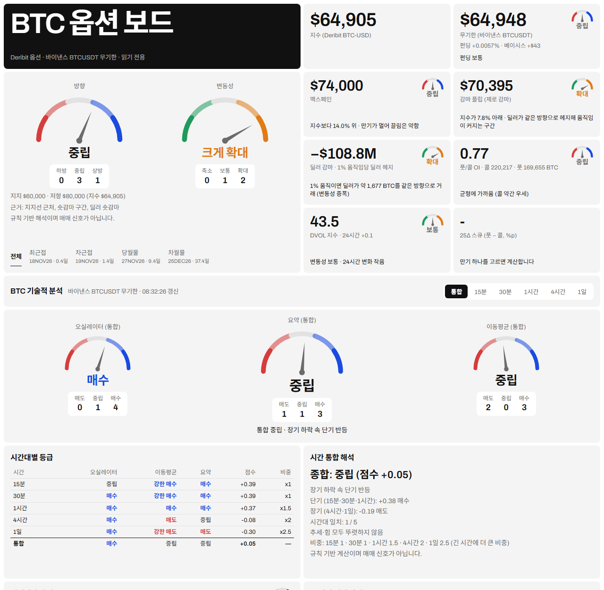

# BTC 옵션 보드

비트코인 옵션 시장의 미시구조를 한 화면에 보여 주는 읽기 전용 페이지입니다.
미국 옵션(QQQ 등)용 "Options Microstructure Terminal"을 참고해 BTC 버전으로 새로 만들었습니다.

- **데이터**: Deribit 공개 API(옵션 미결제약정·거래량·내재변동성, 지수, DVOL)와
  바이낸스 BTCUSDT 무기한(가격·펀딩, WebSocket). 키나 로그인 없이 브라우저가 직접 받습니다.
- **지표**: 맥스페인, 감마 플립(제로 감마), 딜러 순감마(콜 +, 풋 − 표준 가정), 풋/콜 OI,
  25Δ 스큐, DVOL, OI 벽 TOP 10, 24시간 거래 상위 10, 만기별 요약.
  만기는 전체 · 최근접 · 차근접 · 당월물 · 차월물 중에서 고릅니다.
- **기술적 분석**: 바이낸스 BTCUSDT 캔들로 오실레이터 11개(RSI, 스토캐스틱, CCI, ADX, AO, 모멘텀, MACD,
  스토캐스틱 RSI, 윌리엄스 %R, 불 베어 파워, 얼티밋)와 이동평균 15개(EMA·SMA 10~200, 일목 기준선, VWMA, HMA),
  피벗 5종(클래식·피보나치·카마릴라·우디·DM)을 계산해 매수/중립/매도 게이지로 보여 줍니다.
  시간 단위는 15분 · 30분 · 1시간 · 4시간 · 1일, 그리고 다섯 시간대를 가중 평균한 **통합**(15분 1 · 30분 1 · 1시간 1.5 · 4시간 2 · 1일 2.5).
  지표 계산은 `ta.js`, 화면은 `tech.js` 입니다. `ta.js` 값은 pandas_ta 와 대조해 맞췄습니다.
- 계산식은 봇의 `tbot/src/core/options_micro.rs`와 같습니다(텔레그램 `/btcmacross` → 🧰 기타 → 🧮 BTC 옵션 지표).
- 참고용 정보이며 매매 신호가 아닙니다.

## 주소

https://btc-options-board.btc-options-board.workers.dev

## 로컬에서 보기

`index.html`을 브라우저로 열면 바로 동작합니다(같은 폴더의 `tokens.css`, `ta.js`, `tech.js` 필요).

## Cloudflare Workers로 배포

```bash
cd web/btc-options-board
npx wrangler deploy
```


